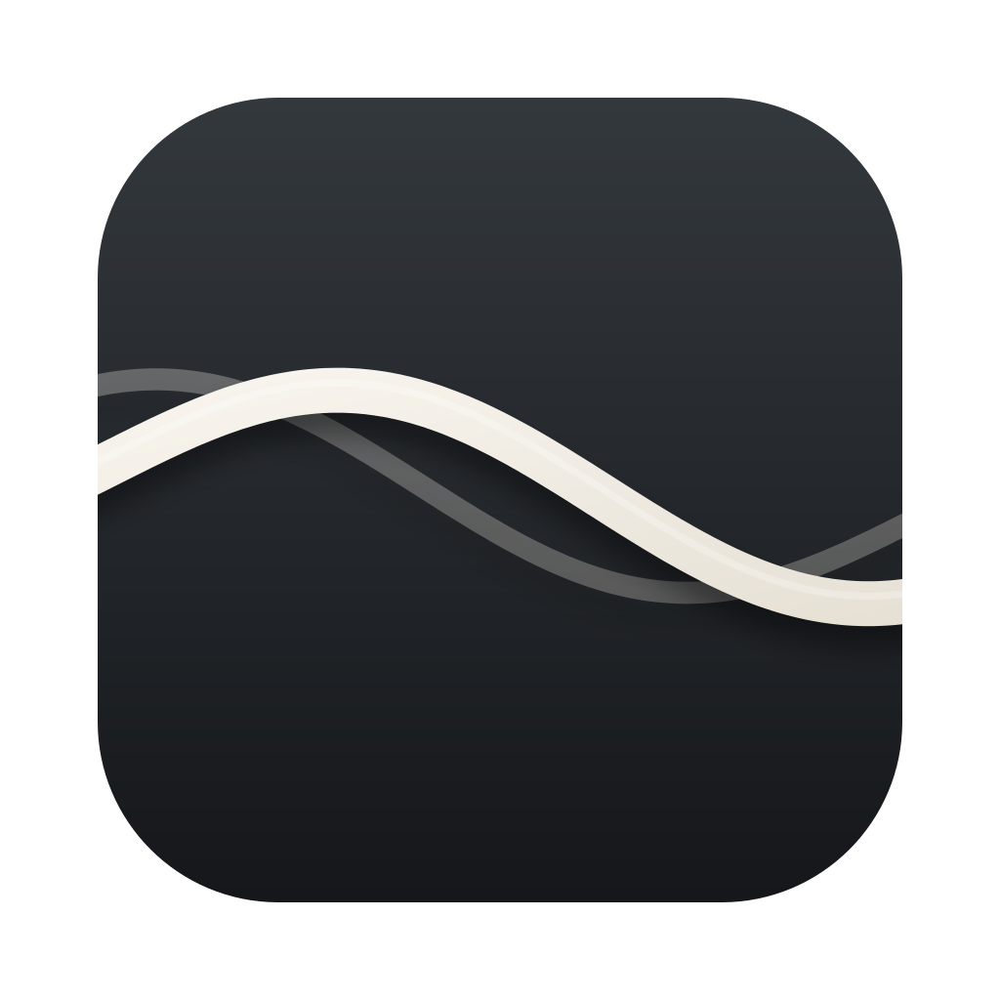
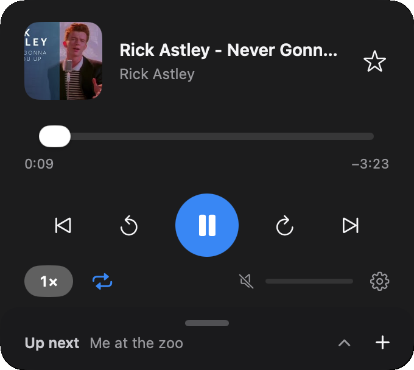

<div align="center">



# sorl

**Just the sound. Quickly.**



</div>

Sorl is a menu bar player for macOS. Paste a YouTube link, or one from any site yt-dlp supports, and it plays only the audio, in the background. Queue what's next, save what you love, and pick up where you left off.

It plays the audio-only stream through the native macOS player, so there is no video decoding, no browser, and nothing to watch. It skips ads by never loading them: it plays the raw audio track directly, the same one AirPods and the Control Center Now Playing widget see.

Built for macOS 26 (Tahoe), and runs on macOS 15 (Sequoia), with a panel that follows light and dark mode and the accessibility display settings.

Say it as one syllable, like "soar" with an L on the end: sorl /soːɭ/. It's Swedish for the murmur of voices.

## Features

- **Paste & play** any YouTube video, playlist, or Music link, or most other sites yt-dlp supports.
- **No ads, no video.** Audio only; typically ~40 MB of memory while playing.
- **Playback controls:** play/pause, back/forward 15 seconds, a scrubber, speeds from 0.75× to 2× with the pitch preserved, **repeat** (off / all / one), and **volume** with a mute toggle.
- **Instant replays, no re-download.** After a YouTube track has been loaded for 20 seconds, its audio is saved to disk in the background. Replaying it, repeating it, or opening it from Recent then plays straight from the file, with no yt-dlp and no network, even days later. Settings sets how much to keep (1 to 10 GB, 2 GB by default), drops the least recently played tracks first, and has a **Clear** button.
- **Up next:** add links to play next or at the end, reorder them, and see what already played. The queue survives a relaunch.
- **Playlists and Mixes:** paste a playlist and it plays through, with next/previous; the next track is fetched ahead of time so changes are quick. A YouTube Mix (`list=RD…`) turns its first 50 tracks into the queue. YouTube only generates Mixes for some videos, mostly music; when there is none, just that video plays and Sorl says so.
- **Chapters:** in a video with YouTube chapters (a DJ mix, say), the panel, the menu bar title, and Now Playing show the chapter playing now. Next/previous skip between chapters.
- **Media keys & Now Playing:** the F7–F9 keys, AirPod taps, and the Control Center widget control Sorl with no setup.
- **Global shortcuts:** configurable hotkeys for play/pause (`⌃⌥P`), cycle speed (`⌃⌥S`), open the panel (`⌃⌥Y`), and next/previous (`⌃⌥→` / `⌃⌥←`).
- **Picks up where you left off:** anything 10 minutes or longer (a DJ mix, a podcast) remembers its position per video, across quits and restarts. Finish it, or scrub back to the start, and it starts over next time. A saved position beats a link's own `t=`.
- **Long mixes start instantly:** YouTube throttles the native player's open-ended requests to about twice real time, which left multi-hour mixes stuck loading. Sorl reads the audio file's segment index and gives the player a playlist of those segments instead, so it fetches only the next few minutes, in ranges YouTube serves at full speed. A two-hour mix starts in well under a second, seeks anywhere instantly, and downloads about 5 MB up front rather than the whole file. Files without an index fall back to fetching in 1 MB ranges.
- **Saved and Recent:** star the track you're hearing (from a Mix or playlist too) to keep it in Saved, and replay anything you played lately from Recent.
- **Volume from the menu bar:** scroll over the icon to change volume; optionally show the track title next to the icon.
- **Keyboard and VoiceOver:** with the panel open, Space plays or pauses, ←/→ skip 15 seconds, ↑/↓ change volume, and Esc goes back or closes. Every control has a VoiceOver label, and the scrubber reads as a time.
- **Stays out of the way:** no Dock icon, low memory, and quitting fully stops everything.

## Requirements

- **macOS 15 (Sequoia) or later**, Apple silicon or Intel. On macOS 26 the panel is Liquid Glass; on 15 it uses the standard popover material.
- **[yt-dlp](https://github.com/yt-dlp/yt-dlp) 2026.08.19 or newer** and a JavaScript runtime (**deno**), both from Homebrew. yt-dlp is the piece that finds the audio stream; YouTube changes often, so keep it current:

  ```sh
  brew install yt-dlp deno
  ```

  Sorl finds yt-dlp on the usual Homebrew paths automatically and tells you in the panel if it is missing or out of date. You can also point it at a specific binary in Settings.

## Install

```sh
brew install --cask karbassi/tap/sorl
```

### Coming from Undertone

On first launch Sorl moves your Undertone data over: Up next, Saved, Recent, playback positions, speed, hotkeys and the downloaded audio. It runs once and never overwrites anything Sorl already has. Launch at login doesn't carry over, so turn it on again in Settings. Then remove the old app with `brew uninstall --cask undertone`.

### Build from source

Building needs the **Command Line Tools** (`xcode-select --install`) or Xcode, plus **[mise](https://mise.jdx.dev)** to run the tasks (`brew install mise`).

```sh
git clone https://github.com/karbassi/sorl.git
cd sorl
mise trust
mise run install  # builds a release .app and copies it to /Applications, then launches it
```

Other tasks (`mise tasks` lists them):

| Command | What it does |
|---|---|
| `mise run build` | Build `build/Sorl.app` without installing. Ad-hoc signed unless the signing variables are set (see Signing). |
| `mise run run` | Build and launch from `build/`. |
| `mise run dev` | Build and run in the foreground with logs in the terminal. |
| `mise run test` | Run the unit tests. |
| `mise run doctor` | Read-only check of yt-dlp, deno, and the build. Changes nothing. |
| `mise run icon` | Regenerate the app icon from `docs/brand`. |
| `mise run clean` | Remove build artifacts. |
| `mise run uninstall` | Quit and remove `/Applications/Sorl.app`. |

To launch it at login, install to `/Applications` and turn on **Open at login** in Settings.

### Signing

By default `mise run build` signs the app ad hoc. An ad-hoc build works, but it can't sync with iCloud. To sign with your own Apple Development certificate, set these environment variables:

| Variable | What it is |
|---|---|
| `SORL_SIGN_IDENTITY` | SHA-1 of the signing certificate (`security find-identity -v -p codesigning` lists them). |
| `SORL_PROFILE` | Path to a provisioning profile for `com.karbassi.sorl` with iCloud (CloudKit) enabled. |
| `SORL_TEAM_ID` | Your Apple Developer Team ID. |
| `SORL_CK_ENV` | CloudKit environment: `Development` or `Production`. |
| `SORL_KEYCHAIN` | Optional. The keychain that holds the certificate, if it isn't in your default keychains. |

Set both `SORL_SIGN_IDENTITY` and `SORL_PROFILE`, or neither. Setting only one is an error. With both set, `SORL_TEAM_ID` and `SORL_CK_ENV` are required.

The easiest place for them is a `.mise.local.toml` in the repo root. It's gitignored, so it stays on your Mac. Keep the profile outside the repo.

```toml
[env]
SORL_SIGN_IDENTITY = "<SHA-1 of your Apple Development cert>"
SORL_PROFILE = "{{env.HOME}}/Library/Developer/Sorl/<your profile>.provisionprofile"
SORL_TEAM_ID = "<your Team ID>"
SORL_CK_ENV = "Development"
```

Run `mise trust` after creating it. To build ad hoc again without deleting it, run `env -u SORL_SIGN_IDENTITY -u SORL_PROFILE ./scripts/bundle.sh`.

Dev builds use the CloudKit Development environment and releases use Production, so the two never share data. What a dev build syncs won't show up in a release build, and the other way round.

The first release signed with Developer ID may ask you to approve **Open at login** again, since macOS sees a new signature. Turn it back on in Settings if it's off.

## Using it

Click the menu bar icon to open the panel. Paste a link to play it (if your clipboard already holds a link, the panel offers it). Right-click the icon for a quick play/pause and Quit menu.

The panel closes when you click away or press Escape. `⌘V` pastes into the panel even though Sorl never steals focus from whatever you are working in.

### URL scheme

Sorl registers `sorl://` so you can drive it from scripts, Shortcuts, or Alfred/Raycast:

```
sorl://play?url=<url>        sorl://play          sorl://pause
sorl://toggle                sorl://next          sorl://previous
sorl://add?url=<url>&mode=next|end                sorl://clear
sorl://speed?value=2         sorl://seek?to=90
sorl://volume?value=0.5      sorl://mute          sorl://repeat?mode=one
sorl://open                  sorl://settings      sorl://close         sorl://quit
sorl://drawer?tab=saved      sorl://save          (toggle the playing track in Saved)
sorl://sync                  (sync with iCloud now)
```

Saved holds up to 500 links on each Mac. iCloud can hold more, so one Mac may show fewer than another.

If a link is removed on one Mac while it's re-saved on another, the removal can win. Save it again if that happens.

Percent-encode the `url` value (`&` becomes `%26`), or the link's own parameters are read as Sorl's.

## How it works

1. You paste a link. Sorl classifies it (video / playlist / mix / other site).
2. It runs `yt-dlp -j` to get the best audio-only stream (AAC in an MP4 container, which the native player can play), preferring the fast `visionos` client and falling back to yt-dlp's default clients.
3. It plays that stream URL with `AVPlayer`: audio only, no video layer. A YouTube stream is played as an HLS playlist built from the file's own segment index, so only the part about to play is fetched.
4. If the track stays loaded for 20 seconds, the whole audio file is downloaded in the background (in bounded ranges YouTube serves at full speed) into `~/Library/Caches/com.karbassi.sorl/Audio`. The next play of that track opens the file instead of the network.
5. It publishes the track to macOS so media keys, AirPods, and Control Center work, and it keeps the panel, scrubber, and speed in sync.

No video is ever downloaded or decoded. yt-dlp's reported duration is used for the progress bar because YouTube's audio files report a misleading length to the player. Resolved stream URLs are cached until they expire, so a replay of a track that isn't saved to disk yet still skips yt-dlp.

The trade-off of the audio cache: the first play of a track costs the stream plus the whole file (about 58 MB per hour of audio), even if you stop early. Tracks skipped within 20 seconds cost nothing extra, files over a quarter of the cache limit are never cached, and every later play costs nothing. `brew uninstall --zap sorl` removes the cache along with the app.

### Performance

Measured on an M1 MacBook Air with `top` and `footprint`, so you can hold it to this:

| State | CPU (one core) | Idle wake-ups | Memory |
|---|---|---|---|
| Idle, nothing loaded | 0% | 0 | ~18 MB |
| Playing, panel closed | ~1% | 0 | ~32 MB |
| Playing, panel open | ~2% | 0 | ~36 MB |
| Playing at 2× | ~4% | ~0 | ~36 MB |
| Paused for 10+ minutes | 0% | ~0 | ~33 MB |

How it stays that way:

- **No timers when you're not looking.** The progress clock runs only while the panel is open. With the panel closed nothing ticks and nothing re-renders; the app just plays audio.
- **Deep idle.** After 10 minutes paused it releases the media pipeline entirely (no buffering, no wake-ups). Pressing Play rebuilds it from the audio or stream cache, instantly. Tune with `defaults write com.karbassi.sorl idleUnloadSeconds -float 300`.
- **Nothing spawned at launch.** yt-dlp is located and version-checked once, then that result is reused for 24 hours (validated cheaply), so launching, including at login, starts no processes. Recheck forces a probe.
- **One yt-dlp at a time.** The background look-ahead (next playlist entry, the link on your clipboard) never runs alongside a resolve you asked for, a link that just failed isn't retried for 10 minutes, and automatic recoveries are capped at two per track. yt-dlp itself is the only real CPU cost, about 3–5 seconds of one core per new link, and only when something has to be resolved.
- **Bounded memory.** Streams and artwork are cached with fixed limits; memory plateaus after a few tracks rather than growing.

### Why it needs yt-dlp

YouTube does not offer a stable public audio URL, and it changes how streams are served often. yt-dlp is the widely maintained tool that keeps up with those changes. Sorl leans on it entirely and never hard-codes anything about YouTube, so when something breaks the fix is almost always:

```sh
brew upgrade yt-dlp
```

The panel says so when it detects a failure that looks version-related (a 403, "requested format is not available", "the page needs to be reloaded", and similar).

## Project layout

```
Sources/SorlCore/        Pure Swift: link parsing, yt-dlp models & client, queue, caches, the Undertone migration. Unit-tested.
Sources/Sorl/            The app: AppKit shell (status item + panel), AVPlayer engine, SwiftUI views, settings.
Sources/SorlSelfTest/    The test suite as a runnable executable (see "Testing" below).
Vendor/KeyboardShortcuts/  Vendored, lightly patched dependency (see Vendor/README.md).
Resources/               Info.plist, the app icon and the menu bar glyphs.
docs/brand/              Icon, glyphs, palette and voice (BRAND.md).
scripts/bundle.sh        Assembles and ad-hoc-signs the .app from `swift build` output, no Xcode needed.
scripts/make-icon.sh     Packs the brand icon into AppIcon.icns.
```

### Testing

Tests live in `Sources/SorlSelfTest` and use [Swift Testing](https://developer.apple.com/documentation/testing). They run as a small executable rather than through `swift test`, because `swift test` does not execute Swift Testing suites when only the Command Line Tools are installed. `mise run test` runs them with either the Command Line Tools or full Xcode; pass-through flags work, e.g. `mise run test -- --filter LinkParser`.

## Troubleshooting

- **"yt-dlp isn't installed" / playback fails immediately.** Run `brew install yt-dlp deno`, then Recheck in the panel. Run `mise run doctor` to see what Sorl sees.
- **A 403, or "requested format is not available".** yt-dlp is behind YouTube. `brew upgrade yt-dlp`.
- **A specific video won't play** but others do. It may be private, age-restricted, members-only, or region-blocked. Sorl will say which.
- **A Mix plays only one video.** YouTube generates Mixes only for some videos (mostly music). Without one, Sorl says so and plays the video.
- **Open at login is greyed out.** Run the built app (`mise run install`), not a bare `swift run` build.

## Notes

This is a personal-use tool. Respect YouTube's Terms of Service and creators' rights; don't use it to redistribute content. It streams for listening, and keeps audio only in its own cache.

## Credit

Inspired by and forked from [Undertone](https://github.com/JoaoCVerissimo/undertone) by João Veríssimo (MIT).

## License

MIT © 2026 Ali Karbassi and João Veríssimo. Bundles [KeyboardShortcuts](https://github.com/sindresorhus/KeyboardShortcuts) by Sindre Sorhus (MIT).
